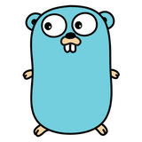

<h1 align="center">
  
</h1>

## 👋 Hello there! May The Force be with you!

I'm **Guilherme**, a developer from Brazil. I work mostly with Python, data and automation, building tools that make everyday work simpler. I enjoy learning new things and figuring out how to turn messy problems into something that just works.

<picture>
  <source media="(max-width: 700px)" srcset="https://raw.githubusercontent.com/zephyyry/zephyyry/main/assets/blank.gif" />
  
</picture>

### 👨🏻‍💻 About me

- Exploring new technologies and building automation and data solutions.
- Always studying; right now, Python, SQL and clean code.
- Working with integrations, internal tools and process automation.
- Learning more about data engineering, APIs and cloud.
- Gaming, design and side projects as hobbies.
- How to reach me: [GitHub](https://github.com/zephyyry)

 

  <picture>
    <source media="(min-width: 701px)" srcset="https://raw.githubusercontent.com/zephyyry/zephyyry/main/assets/blank.gif" />
    
  </picture>

### 💻 Languages and Tools

<h4 align="center">Languages</h4>

  
  
  
  
  
  
  
  

<h4 align="center">Tools & Workflow</h4>

  
  
  
  
  
  
  
  

<h4 align="center">Platforms & Hardware</h4>

  
  
  
  
  

<h4 align="center">Frameworks & Libraries</h4>

  
  
  
  

<h4 align="center">Databases</h4>

  
  
  
  

---

⭐ From [Guilherme](https://github.com/zephyyry) — thanks for stopping by!
