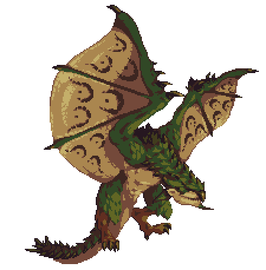
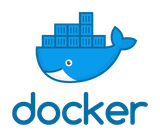
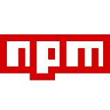
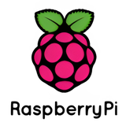
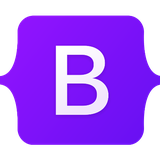
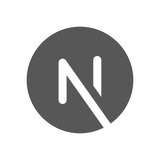
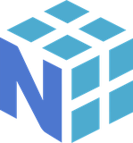

## Hello there! May The Force be with you!

I'm **Guilherme**, a developer from Brazil. I work mostly with Python, data and automation, building tools that make everyday work simpler. I enjoy learning new things and figuring out how to turn messy problems into something that just works.

<picture>
  <source media="(max-width: 700px)" srcset="https://raw.githubusercontent.com/zephyyry/zephyyry/main/assets/blank.gif" />
  
</picture>

### About me

- Building internal tools, integrations and process automation.
- Studying Python, SQL and clean code, with an eye on data engineering, APIs and cloud.
- Open to new opportunities.
- How to reach me: [GitHub](https://github.com/zephyyry)

  <picture>
    <source media="(min-width: 701px)" srcset="https://raw.githubusercontent.com/zephyyry/zephyyry/main/assets/blank.gif" />
    
  </picture>

<picture>
  <source media="(max-width: 700px)" srcset="https://raw.githubusercontent.com/zephyyry/zephyyry/main/assets/blank.gif" />
  
</picture><picture>
  <source media="(max-width: 700px)" srcset="https://raw.githubusercontent.com/zephyyry/zephyyry/main/assets/blank.gif" />
  
</picture>

- Mostly indies and RPGs for the story, Monster Hunter for the grind.
- Sci-fi, Star Wars novels and philosophy, mostly Hegel.
- Side projects that start as scripts and end as tools I actually use.

 

  <picture>
    <source media="(min-width: 701px)" srcset="https://raw.githubusercontent.com/zephyyry/zephyyry/main/assets/blank.gif" />
    
  </picture>

### Languages and Tools

<h4 align="center">Languages</h4>

  
  
  
  
  

<h4 align="center">Tools & Workflow</h4>

  
  
  
  
  
  
  
  

<h4 align="center">Platforms & Hardware</h4>

  
  
  
  
  

<h4 align="center">Databases</h4>

  
  
  
  

<h4 align="center">Frameworks & Libraries</h4>

  
  
  
  
  
  
  
  

---

  

From [Guilherme](https://github.com/zephyyry) — thanks for stopping by!
